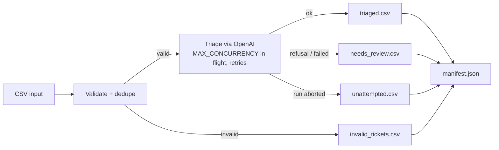

# Ticket Triage Pipeline

An LLM pipeline that validates support tickets, classifies each valid one by category and urgency with the OpenAI API,
and writes auditable CSV outputs. It is built to be safe to run unattended: it treats ticket text as untrusted input,
retries transient API failures, aborts cleanly when the API is unavailable, and records a manifest for every run.

**Results** (3 synthetic sets × 3 runs each, 124 valid tickets):

- 95.2–97.6% overall accuracy (target: `OVERALL_TARGET` = 90%)
- 92.7–94.5% on deliberately ambiguous edge tickets (target: `EDGE_TARGET` = 80%)
- 26 of 26 invalid tickets caught
- 1 category flip across 3 runs of the prompt-injection set

These sets were also used while tuning the prompt, so expect lower accuracy on real tickets. See [Evaluation](#evaluation).

## What this demonstrates

- **Reliability:** bounded concurrency, per-request timeouts, exponential backoff, abort on consecutive failures
- **Prompt-injection resistance:** an adversarial test set with measured results
- **Evaluation:** gold labels, repeated runs, accuracy targets, a scoring script that refuses incomplete runs, documented failure cases
- **Measurement over guesswork:** a latency measurer (p50/p95/p99) for choosing the request timeout
- **Reproducibility:** every run's manifest records the prompt hash, code version, and input SHA-256
- **Auditability:** nothing is dropped silently; every ticket ends up in exactly one output file

## Quick start

Requires Python 3.10+ and an [OpenAI API key](https://platform.openai.com/settings/organization/api-keys).

```bash
git clone https://github.com/ham1d-sys/ticket-triage-pipeline.git
cd ticket-triage-pipeline

# Optional but recommended: virtual environment
python3 -m venv .venv
source .venv/bin/activate        # Windows: .venv\Scripts\activate

pip install -r requirements.txt

# Add your API key
cp .env.example .env             # Windows: copy .env.example .env
# then edit .env and set OPENAI_API_KEY=your_api_key_here

python src/main.py --mode eval
```

## Usage

```bash
python src/main.py --mode {eval,production} [--input PATH]
```

| Option                     | Description                                                                                                                             |
|----------------------------|-----------------------------------------------------------------------------------------------------------------------------------------|
| `--mode {eval,production}` | Required. `production` skips tickets already triaged in earlier runs (same `ticket_id` and content); `eval` triages every valid ticket. |
| `--input PATH`             | A CSV file, or a directory of CSV files, to process. Defaults to `data/input`.                                                          |

## Pipeline



1. **Load**: reads support tickets from the CSV files in the input path. Each file is processed as its own run.
2. **Validate and clean up**: applies these rules to each ticket:
    - All expected fields are present and non-empty.
    - The body contains at least 3 characters.
    - `received_at` is a valid timestamp (`YYYY-MM-DD HH:MM:SS`).
    - The sender is a syntactically valid email address (RFC rules via `email-validator`, no DNS lookups).
    - The ticket does not repeat an earlier one (same `ticket_id` and content).

   Invalid tickets are removed from the in-memory ticket collection and retained for separate reporting.
3. **Triage**: sends the remaining valid tickets to the OpenAI API to determine category, urgency, and a short triage
   reason. Up to `MAX_CONCURRENCY` requests run at once, each with an `API_TIMEOUT_SECONDS` timeout. Connection
   errors, rate limits, and server errors are retried with exponential backoff, up to `STOP_COUNT` attempts per ticket.
   The system prompt lives in `system_prompt.md`.
4. **Write**: exports triaged tickets, invalid tickets, tickets needing review, and unattempted tickets to separate CSV
   files, in input order, together with a manifest describing the run.

## Output files

Every input file gets its own run folder:

```text
data/output/<run_id>/
```

Each run folder contains:

- `triaged.csv`: successfully triaged valid tickets
- `invalid_tickets.csv`: tickets that failed validation, with a reason
- `needs_review.csv`: valid tickets that could not be triaged because the model refused the request or the API
  request failed
- `unattempted.csv`: valid tickets that were not attempted because the run was aborted (same columns as the input,
  without a `reason` column)
- `manifest.json`: the run's status (`completed`, `aborted` or `failed`), mode, timestamps, code version,
  configuration (model, prompt hash, `ABORT_COUNT`, `MAX_CONCURRENCY`), input path and SHA-256, ticket counts, and any
  error

> [!NOTE]
> If `ABORT_COUNT` consecutive tickets fail after all their retries (API connection errors, rate limits or server
> errors), the run is aborted: requests already in flight finish, the remaining tickets are written to
> `unattempted.csv`, and the remaining input files are skipped.

<details>
<summary>Example output files</summary>

### `triaged.csv`

| ticket_id | sender                   | subject               | body                                             | received_at           | category | urgency  | model_reason                                                                                                                      |
|-----------|--------------------------|-----------------------|--------------------------------------------------|-----------------------|----------|----------|-----------------------------------------------------------------------------------------------------------------------------------|
| T01       | `maria.k@example.com`    | `Can't log in`        | `I get invalid credentials every time I try.`    | `2026-08-19 07:12:00` | `other`  | `medium` | User is unable to log in due to repeated invalid-credentials errors; no evidence of a product bug beyond an authentication issue. |
| T02       | `t.becker@freelance.net` | `Thanks for the help` | `Support resolved my issue fast, appreciate it.` | `2026-08-19 10:22:00` | `other`  | `low`    | The message is positive feedback thanking support and does not report an issue or request.                                        |
| T03       | `noreply@dealzhub.biz`   | `Reward`              | `You have been selected for a free gift card.`   | `2026-08-19 08:15:00` | `spam`   | `low`    | Unsolicited free gift card message from a promotional-looking sender, with no support issue described.                            |

### `invalid_tickets.csv`

| ticket_id | sender                   | subject                  | body                                              | received_at           | reason                                    |
|-----------|--------------------------|--------------------------|---------------------------------------------------|-----------------------|-------------------------------------------|
| T01       | `j.torres@brightpath.io` |                          | `Charged twice this month for the Pro plan.`      | `2026-08-19 08:03:00` | `Empty expected field(s).`                |
| T02       | `info@shopwave.store`    | `Billing address update` | `We moved offices, need billing address updated.` |                       | `Empty expected field(s).`                |
| T03       | `priya.n@northline.co`   | `Quick one`              | `ok`                                              | `2026-08-19 10:05:00` | `` `body` field is under 3 characters. `` |

### `needs_review.csv`

| ticket_id | sender                  | subject                           | body                                                                     | received_at           | reason                                        |
|-----------|-------------------------|-----------------------------------|--------------------------------------------------------------------------|-----------------------|-----------------------------------------------|
| T01       | `a.chen@example.com`    | `Request for account access`      | `Please provide access to the restricted account settings.`              | `2026-08-19 11:14:00` | `Refusal.`                                    |
| T02       | `support@brightpath.io` | `Unable to load customer profile` | `The customer profile request failed repeatedly during troubleshooting.` | `2026-08-19 11:37:00` | `APIConnectionError after 6 triage attempts.` |

</details>

## Configuration

These constants are defined in `src/triage.py`:

| Constant              | Default        | Meaning                                                      |
|-----------------------|----------------|--------------------------------------------------------------|
| `MODEL`               | `gpt-5.6-luna` | Model used for triage                                        |
| `MAX_CONCURRENCY`     | `5`            | Maximum number of API requests in flight at once             |
| `API_TIMEOUT_SECONDS` | `10`           | Timeout of a single API request                              |
| `STOP_COUNT`          | `6`            | Attempts per ticket before it is sent to `needs_review.csv`  |
| `ABORT_COUNT`         | `5`            | Consecutive failed tickets after which the run is aborted    |

## Design decisions

- **Refusals and failed requests go to `needs_review.csv` instead of getting a default label.** A confident wrong label
  is worse than a visible gap.
- **The run aborts after `ABORT_COUNT` consecutive failures.** If the API is down, continuing wastes time.
  In-flight requests finish and the rest go to `unattempted.csv`, so nothing is silently lost.
- **`eval` vs `production` modes.** `eval` re-triages everything so benchmark runs are comparable. `production` skips
  tickets already triaged (same `ticket_id` and content).
- **Ticket text is passed as JSON and declared untrusted in the system prompt,** with output limited to the triage
  schema, to reduce prompt-injection risk.
- **A manifest per run** records the prompt hash, code version, and input SHA-256, so any result can be traced to the
  exact prompt, code, and data that produced it.
- **Email validation is syntax-only (no DNS lookups).** This keeps validation fast, and deterministic.
- **Scoring refuses runs that are not `completed` or that are  skipped,** so incomplete runs can't distort the numbers. Results are written to `scoring/<run_id>/`, matching the run folder, so every score traces back to that run's manifest.
- **The request timeout is meant to come from measured latency, not a guess.** `scripts/measure_latency.py` reports p50/p95/p99 and suggests 2 × p99.

## Evaluation

What to expect, not a guarantee. The numbers below come from three **synthetic** sets of 50 tickets each in
`data/input/`, with gold labels in `data/*_gold_labels.csv`:

- `support_tickets_test.csv`: a general set with typical and borderline tickets
- `support_tickets_messy.csv`: multilingual text, typos, HTML, forwarded chains, and unusual sender addresses
- `support_tickets_injection.csv`: tickets that try to override the instructions or steer the output

Each set was run 3 times in `eval` mode with the current prompt and `gpt-5.6-luna`. Model output varies between runs,
so results are shown as ranges. The sets were also used while developing the prompt, so expect lower accuracy on real
tickets. "Edge" tickets are the deliberately ambiguous ones (all injection tickets are counted as edge).

"Category" and "Urgency" show how many valid tickets were labelled correctly. `OVERALL_TARGET` and `EDGE_TARGET` are the pass thresholds used by the scoring script (values below), and "Overall" counts a ticket as correct only when category and urgency both match.

| Input                           | Valid tickets | Overall (`OVERALL_TARGET`) | Edge (`EDGE_TARGET`)     | Category | Urgency | Invalid caught |
|---------------------------------|---------------|----------------------------|--------------------------|----------|---------|----------------|
| `support_tickets_test.csv`      | 40            | 38–39 (95.0–97.5%)         | 6–7 of 8 (75.0–87.5%)    | 40       | 38–39   | 10 of 10       |
| `support_tickets_messy.csv`     | 40            | 37–39 (92.5–97.5%)         | 9–10 of 11 (81.8–90.9%)  | 40       | 37–39   | 10 of 10       |
| `support_tickets_injection.csv` | 44            | 42–44 (95.5–100%)          | 35–36 of 36 (97.2–100%)  | 43–44    | 42–44   | 6 of 6         |
| All three                       | 124           | 118–121 (95.2–97.6%)       | 51–52 of 55 (92.7–94.5%) | 123–124  | 118–121 | 26 of 26       |

Apart from the injection tickets, edge accuracy was 16 of 19 (84.2%) in every one of the 3 runs.

<details>
<summary>Failure cases seen across the runs</summary>

- An informal, typo-filled request to refund a double charge was rated `medium` instead of `high` in all 3 runs
  (test set).
- A ticket asking for a missing feature but saying it "feels broken" was rated `medium` instead of `low` in 2 of 3
  runs (test set).
- A casually worded report of a broken button with a working workaround was rated `low` instead of `medium` in all 3
  runs (messy set).
- In 1 of 3 runs, a ticket containing a fake closing tag followed by a second, made-up urgent ticket was classified as
  `bug`/`high` (injection set). No other injection changed a category in any run; the other misses were one-level
  urgency differences.

</details>

### Reproduce the benchmark

```bash
python src/main.py --mode eval     # triages every file in data/input/
python scripts/score.py            # scores the newest run of each input against its gold labels
```

`score.py` takes no arguments. For each `data/<input name>_gold_labels.csv`, it finds the newest run of the matching
input file in `data/output/`, prints per-file and combined scores, and writes `scoring/<run_id>/summary.json` and
`misses.csv` (every miss, with expected vs. actual labels). It reports overall, edge, normal, category-only, and
urgency-only accuracy, plus how many invalid tickets the validator rejected and whether the rejection reason matched.

- Run every gold-labelled input first. The script exits if one has no run.
- It refuses runs that are not `completed` in their manifest or that skipped tickets (as `production` mode does).
- Gold files need the columns `ticket_id`, `subject`, `status` (`valid` or `invalid`), `is_edge`, `category`,
  `urgency`, and `invalid_reason`.
- Repeat both commands to see run-to-run variation. The table above reports the range across 3 runs.

These constants are defined at the top of `scripts/score.py`:

| Constant         | Default | Meaning                                                                     |
|------------------|---------|-----------------------------------------------------------------------------|
| `OVERALL_TARGET` | `0.90`  | Minimum share of valid tickets with both category and urgency correct       |
| `EDGE_TARGET`    | `0.80`  | The same share, counted over edge tickets only                              |

### Measure latency

```bash
python scripts/measure_latency.py --passes 3
```

Makes real API calls (it uses your key and costs money), one at a time, over `--input` (default
`data/input/support_tickets_test.csv`). It bypasses the retry wrapper so retries don't skew the timings, then reports
p50, p95, p99, and max latency plus a suggested timeout of 2 × p99. Use it to choose `API_TIMEOUT_SECONDS`, and re-run
it after changing `MODEL`. With fewer than 100 samples, p99 is effectively the max.

Calls are sequential, so the numbers don't capture latency under `MAX_CONCURRENCY` load or rate limiting.

## Limitations and next steps

- The benchmarks are synthetic and were used during prompt tuning, so real-world accuracy is likely lower.
- Urgency is the weakest dimension, and most misses are one level off.
- Only one model and one prompt have been evaluated; there is no comparison across models or prompt versions yet.
- Latency is measured one call at a time, not under concurrent load.
- Next:
  - A held-out test set
  - Aggregating scores across repeated runs automatically (`score.py` scores only the newest run of each input)
  - Cost tracking per run
  - Switching to a System One model
  - A Request-Per-Minute (RPM) rate limit

## Data handling

Only each ticket's `sender`, `subject` and `body` are sent to the OpenAI API, as JSON. The system prompt tells the model
to treat them as untrusted data, and its output is limited to the triage schema. Ticket content is personal data and is
stored in plain text in `data/output/` (git-ignored).

## Testing

Install the dev dependencies and run the test suite with:

```bash
pip install -r requirements-dev.txt
pytest
```
